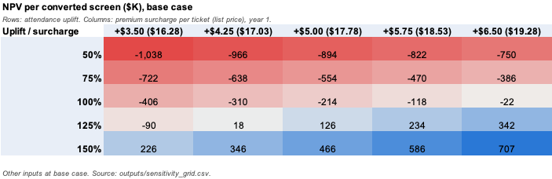

# Premium-screen investment model

Author: Saathvik Maheshuni

Should a U.S. movie theater chain turn some of its regular screens into premium screens like IMAX or Dolby Cinema? I built an Excel model of the cash flows from converting one screen over 10 years. It has three scenarios (base, upside and downside), a sensitivity table, and a one-page memo with my recommendation for an executive team. I used AMC's public numbers to stand for a large U.S. chain. This is my own analysis, not AMC's.

Tableau dashboard: [Premium-screen conversion: NPV per screen by scenario](https://public.tableau.com/app/profile/saathvik.maheshuni/viz/Premium-screeninvestmentmodel/Premium-screenconversionNPVperscreenbyscenario)

## What I found

My recommendation is to convert only some screens, not all of them. In the base case, converting a screen costs $1.39 million. At a 9.5% discount rate the NPV is -$213,905 per screen, the IRR is 6.1%, and payback takes 7.5 years. In the upside case the NPV is $1,647,821 (IRR 32.5%, payback 3.0 years). In the downside case the screen loses $1,794,151 and does not pay back within 10 years.

The base case breaks even if attendance on the screen goes up by 115.7% (I call this the attendance uplift). It would also break even with a $6.67 premium surcharge at the base-case uplift. NPV turns positive at a 125% uplift once the surcharge is $4.25 or more. At a 150% uplift it is positive for every surcharge I tested, from $3.50 to $6.50.

So why is the base case negative? Studios take 51.2% of ticket revenue. The premium format partner takes a share of the whole screen's box office. I also assumed half of the extra customers would have gone to one of the chain's other screens anyway. Because of this, converting only makes sense for screens that can bring in a lot more people than before.

## Data and sources

All the public numbers come from two SEC filings. The workbook's Inputs sheet and [data/public_inputs.csv](data/public_inputs.csv) give the page number for each one.

- AMC Entertainment Holdings, Form 10-K for fiscal 2025, filed 2026-02-23 ([SEC EDGAR](https://www.sec.gov/Archives/edgar/data/1411579/000141157926000016/amc-20251231x10k.htm)). I used it for U.S. admissions, attendance, screens, operating costs, film and food cost rates, food and drink spending per customer, the discount rate AMC uses for its U.S. theatres, and its tax losses carried forward.
- IMAX Corporation, Form 10-K for fiscal 2025, filed 2026-02-25 ([SEC EDGAR](https://www.sec.gov/Archives/edgar/data/921582/000162828026011770/imax-20251231.htm)). I used it for rental revenue and box office at revenue-sharing theaters (which give a 14.7% average revenue share), revenue per new system, contract terms, and IMAX's share of U.S. screens and box office.

SEC filings are public records, so the numbers can be used freely, and I cite each one. Some numbers have no public source, like the attendance uplift, the surcharge, how many customers come from the chain's other screens (cannibalization), and construction cost. The Inputs sheet marks these as assumptions and gives a one-line reason for each.

## How the model works

The model has five main sheets. Inputs has every public number and assumption. Blue cells are inputs you can change, black cells are formulas, and each row shows its source or reason. Model builds the 10-year cash flow for the scenario picked in cell Inputs!B3. Year 0 has the conversion cost and the weeks the screen is closed. Each year after that has the extra ticket sales, film rent, the partner's share, food and drink profit, and extra operating costs. Scenarios shows all three scenarios side by side. Sensitivity shows NPV for different attendance uplifts and premium prices and finds the break-even points. Summary pulls together the results and a recommendation that updates with the formulas. The workbook also has a Checks sheet, a Charts sheet, and one sheet for each CSV in outputs/ (scenario_results, scenario_cash_flows, sensitivity_grid, key_metrics, model_inputs, tableau_extract and public_inputs). Those sheets are all formulas that point back to the model, so they update when an input changes.

Every calculated cell is a formula that links back to Inputs. The workbook calculates with zero formula errors in Excel. It has checks that the sheets agree with each other, and the Checks sheet works out the three NPVs a second way with Excel's own NPV function and gets the same answers.

## Files

| Path | What it is |
|---|---|
| deliverables/premium_screen_model.xlsx | The model: Inputs, Model, Scenarios, Sensitivity, Summary, plus Checks, Charts and the export sheets |
| deliverables/investment_memo.pdf, .md | One-page memo with my recommendation |
| outputs/scenario_results.csv | NPV, IRR, payback and the main assumptions for each scenario |
| outputs/scenario_cash_flows.csv | Yearly and running total cash flow for each scenario |
| outputs/sensitivity_grid.csv | NPV for each attendance uplift and premium price |
| outputs/key_metrics.csv, model_inputs.csv | Break-even points, and every model input with its source |
| outputs/tableau_extract.csv | The three tables above in one file for the dashboard |
| outputs/*.png | Pictures of the charts on the workbook's Charts sheet: scenario NPV, cumulative cash flow and the sensitivity table |
| data/public_inputs.csv | The public numbers with their document and page |

## How to run it

Everything runs in Excel. Open the workbook and change any blue cell on Inputs, and every sheet updates, including the checks, the charts and the export sheets. To refresh a CSV, keep Inputs!B3 at 1 (the base case), click the export sheet with the same name, and use File > Save As > CSV to save it into outputs/ (or data/ for public_inputs). Excel only saves the sheet you are on, so open the .xlsx file again before saving the next one.

## Limitations

The model looks at one screen using AMC's averages, multiplied by an assumed 1.25 because a chain would pick its bigger auditoriums to convert. The attendance uplift, cannibalization, surcharge and construction cost are my own assumptions with no public benchmark, and they have a big effect on the result. For equipment cost I used IMAX's revenue per new system. That number mixes full sales with partial-payment deals, and I count it in every scenario. In a normal revenue-sharing deal IMAX would pay for most of the equipment, so the downside case is on the cautious side. The model leaves out ticket fees, on-screen ads, and any extra food spending by premium customers, so it understates the benefit. It also assumes no cash taxes because of AMC's tax losses carried forward. A company that pays taxes would get lower returns.
